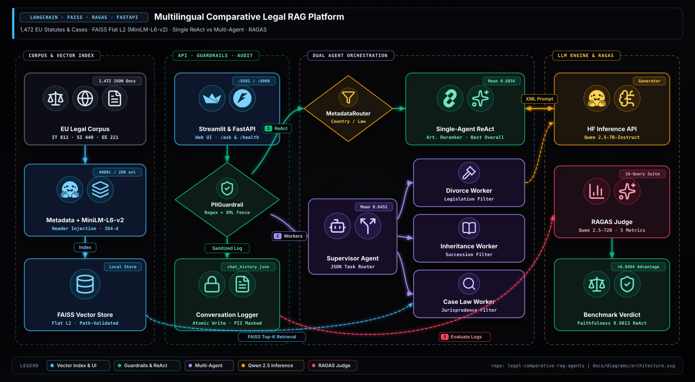

# Multilingual Comparative Legal RAG Platform (Single-Agent vs. Multi-Agent)

An end-to-end **Retrieval-Augmented Generation (RAG)** and **LLMOps evaluation** platform comparing **Single-Agent ReAct** and **Hierarchical Multi-Agent Supervisor** architectures over comparative European civil law (**Italy**, **Slovenia**, **Estonia**), featuring **PII Guardrails**, **XML Anti-Prompt-Injection Boundaries**, **FAISS Flat L2** hybrid metadata routing, **Streamlit** UI, **FastAPI** REST serving, and **RAGAS** automated benchmarking.

> **Academic Context:** Developed for the *Text Mining* course (Prof. Flora Amato, A.Y. 2025/2026) at the University of Naples Federico II (DIETI) by **Giuseppe Ruggiero** (`M63001719`), **Filomena Vigliotti** (`M63001734`), and **Francesco Panico** (`M63001766`).

---

## Architecture Overview



### Legal Corpus Breakdown (`data/` — 1,472 JSON Documents)

| Jurisdiction | Divorce Statutes | Inheritance Statutes | Court Cases | Total Documents |
| --- | ---: | ---: | ---: | ---: |
| **Italy** | 38 | 303 | 470 | **811** |
| **Slovenia** | 30 | 209 | 201 | **440** |
| **Estonia** | 50 | 49 | 122 | **221** |
| **Total Corpus** | **118** | **561** | **793** | **1,472** |

Every ingested JSON document is enriched via **Metadata Injection** (`FILENAME`, `COUNTRY`, `TYPE`, `CASE ID`, `RELATED ARTICLES`) before splitting (`chunk_size = 4000`, `chunk_overlap = 200`) and indexing into **FAISS Flat L2** using `sentence-transformers/all-MiniLM-L6-v2` (384-d embeddings).

---

## Comparative Agentic Topologies

1. **Single-Agent ReAct (`backend/single_agent/single_agent.py`)**
   - Classifies retrieval necessity (`Thought`), extracts country/legal-domain/jurisprudence filters via `MetadataRouter` (`Action`), prioritizes statutory article citations via regex reranking, generates white-box source summaries (`Observation`), and answers strictly from retrieved passages (`Qwen/Qwen2.5-7B-Instruct`).
2. **Hierarchical Multi-Agent Supervisor (`backend/multi_agent/supervisor.py`)**
   - Routes queries dynamically via JSON delegation to three metadata-scoped worker specialists (`DIVORCE_LAW`, `INHERITANCE_LAW`, `CASE_LAW`) sharing one FAISS instance in memory, then synthesizes cross-jurisdictional reports.

---

## Verified 10-Query RAGAS Benchmark (`Qwen/Qwen2.5-72B-Instruct` Judge)

Evaluated over the paired 10-query comparative legal benchmark (`logs/evaluation_references.json`):

| Architecture | Faithfulness | Answer Relevancy | Context Precision | Context Recall | Answer Correctness | Overall Mean |
| --- | ---: | ---: | ---: | ---: | ---: | ---: |
| **Single-Agent ReAct** | **0.9013** | 0.5673 | **0.6589** | **0.7500** | 0.5503 | **0.6856** (`+0.0404`) |
| **Multi-Agent Supervisor** | 0.6876 | **0.6707** | 0.5977 | 0.7000 | **0.5700** | 0.6452 |

- **Key Empirical Takeaway:** Single-Agent ReAct achieves substantially stronger faithfulness (`0.9013`) and retrieval recall (`0.7500`) by filtering metadata globally without hard partitioning bottlenecks, whereas the Multi-Agent Supervisor excels on **Answer Relevancy** (`0.6707`) and **Answer Correctness** (`0.5700`) through structured multi-report synthesis.

---

## Security, Privacy & Reliability Hardening

- **Prompt Injection Isolation (`backend/retrieval_utils.py`)**: All user inputs, retrieved legal excerpts, and worker reports are fenced inside XML tags (`<USER_QUERY>`, `<RETRIEVED_CONTEXT>`, `<EXPERT_REPORTS>`) with escaped closing markers and explicit system precedence rules.
- **PII Redaction Guardrails (`backend/guardrails.py`, `backend/logger.py`)**: Regex sanitization strips emails, phone numbers, Italian Tax IDs, IBANs, titles, signatures, and contractual party names on both queries and generated answers before UI display or persistence.
- **Atomic Log Persistence (`backend/logger.py`)**: Thread-locked `tempfile` + `os.replace` writes replace unsafe `r+` seek overwrites to eliminate JSON corruption under concurrent FastAPI/Streamlit requests.
- **Word-Boundary Routing Fix (`backend/metadata_router.py`)**: Compiled `\b` regex boundaries prevent English substring collisions (such as matching `"heir"` inside `"their"`).
- **Safe API & Config Lifecycle (`api.py`, `backend/configuration.py`, `backend/vector_store.py`)**: Lazy FAISS/LLM initialization returning `503` when the index is not yet built, Pydantic length limits, generic `500` error responses (`CWE-209`), path-validated local FAISS loading, and atomic config updates preserving `EVAL_LLM_REPO_ID`.

---

## Repository Structure

```text
legal-comparative-rag-agents/
├── Homepage.py                      # Streamlit entrypoint & system readiness check
├── api.py                           # FastAPI REST endpoints (/health, /ask)
├── Dockerfile & docker-compose.yml  # Dual-container UI (8501) + API (8000) loopback deployment
├── backend/
│   ├── configuration.py             # Atomic RagConfig loader/saver
│   ├── guardrails.py                # PII redaction rules (EN/IT)
│   ├── metadata_router.py           # Hybrid country/topic/doc_type regex router
│   ├── retrieval_utils.py           # Shared XML fencer, article reranker & white-box observer
│   ├── load_data.py                 # Recursive JSON loader + Metadata Injection
│   ├── vector_store.py              # FAISS Flat L2 manager with path safety verification
│   ├── llm_provider.py              # HuggingFace Inference wrappers + rate-limited eval judge
│   ├── logger.py                    # Atomic PII-masked conversation logger
│   ├── evaluator.py                 # 5-metric RAGAS benchmark runner
│   ├── single_agent/single_agent.py # ReAct agent implementation
│   └── multi_agent/                 # Supervisor & specialized legal workers
├── pages/                           # Streamlit multi-page UI (Config, DB Builder, Chatbot, Eval)
├── data/                            # 1,472 legal JSON statutes & court cases (EE / IT / SI)
├── logs/evaluation_references*.json # Paired 10-query RAGAS ground-truth benchmark
├── tests/                           # Unit & API tests without requiring live HF credentials
└── docs/diagrams/architecture.svg   # Obsidian-black system architecture schema
```

---

## Setup & Execution

1. **Configure credentials:**

```bash
cp .env.example .env
# Set HF_TOKEN=hf_... in .env
```

2. **Install dependencies and verify corpus ingestion:**

```bash
pip install -r requirements.txt
python -m backend.load_data
```

3. **Run with Streamlit + FastAPI (or Docker Compose):**

```bash
streamlit run Homepage.py --server.port 8501 --server.address 127.0.0.1
uvicorn api:app --host 127.0.0.1 --port 8000
# Or: docker compose up --build
```

4. **Run automated unit & API tests:**

```bash
pytest tests -v
```
